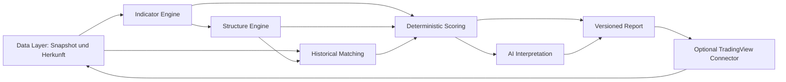

# Evaluation einer reproduzierbaren Chartanalyse mit TradingView

Stand: 8. November 2026. Prüfstand: `kevinmeix1/Stock-Trading-Agent`, Commit `8e9246bdfa87fac2c0ed6f6f488419e699cd043f`.

**Entscheidung:** Das bestehende Projekt als Service-, Daten- und Berichtsgerüst weiterverwenden. Die quantitative Analyse unabhängig von TradingView ausführen und TradingView optional über einen austauschbaren Desktop-Adapter anbinden. Als Ergänzungen TA-Lib für Referenzberechnungen, STUMPY für feste Suchfenster und begrenztes DTW über tslearn erproben. Die Auswahl ist eine begründete Technologieentscheidung; eine überlegene Prognoseleistung ist damit noch nicht nachgewiesen.

Der öffentliche Kandidat wurde anhand des vom Auftrag genannten Repository-/Paketnamens ausgewählt. Es wird keine Verbindung dieses Projekts zum lokalen Market Desk unterstellt. Diese Phase enthält Dokumentation und isolierte Prüfskripte, keine Änderungen an produktiven Analysefunktionen.

## A. Bestandsprüfung und Repository-Vergleich

### Vorhandener Code und tatsächliche Grenzen

README, Architekturtext, PDF-Generator, Daten-, Agenten-, Modell-, Orchestrierungs-, Memory-, Backtest-, Service- und API-Code sowie Tests wurden geprüft. Der PDF-Generator wiederholt die Architektur; eine visuelle PDF-Abnahme gehört nicht zu dieser fachlichen Evaluation. Offene Issues zum Abrufzeitpunkt: keine. Die vollständigen Commit-Pins und inspizierten Dateien stehen in [source-lock.json](source-lock.json).

Das Projekt deklariert MIT in `pyproject.toml`; eine eigenständige LICENSE-Datei fehlt im geprüften Tree. Der letzte geprüfte Commit stammt vom 29. Juni 2026. Konkrete Quellbelege sind in [EVIDENCE.md](EVIDENCE.md) verlinkt.

| Bereich | Implementiert | Abgrenzung zu Dokumentation und Planung |
|---|---|---|
| Daten | `MarketDataProvider.history()`, synthetische OHLCV und optional yfinance-Tagesdaten, `PriceHistory` | Kein TradingView-Connector, keine Intraday-/MTF-Schnittstelle, keine Quellen-/Währungs-/Adjustment-Metadaten. Intraday ist eine Erweiterungsidee. |
| Indikatoren | SMA, EMA, RSI, MACD, Bollinger, ATR, OBV, Volumenrelation, Volatilität und kompakter Snapshot | Kein ADX, keine Swing-Struktur oder Chartformationen; Initialisierung weicht von anderen Bibliotheken ab. |
| Bewertung | Fünf Analysten-Heuristiken; gewichtete Signale mit Abschlag bei Uneinigkeit; Debate, Positionsgrößen und Entscheidungen | Die Konfidenzen sind Formeln bzw. Modellangaben, keine gemessenen Erfolgswahrscheinlichkeiten. Eine empirische Kalibrierung ist nicht implementiert. |
| Fundamentales | `FundamentalAnalyst` verarbeitet Werte im Scratchpad oder erzeugt symbolabhängige Pseudodaten | Der öffentliche Pipeline-Aufruf beschafft keine echten Unternehmenskennzahlen. Auch yfinance-Kurshistorie ersetzt diesen Platzhalter nicht. |
| Nachrichten und Makro | Übergebene Headline-Strings werden mit Wortlisten bewertet; sonst Kursproxy. Makro nutzt Asset-Volatilität und Symbolproxy. | Kein automatischer Nachrichtenfeed, keine Quellenprüfung, keine datierte Makrohistorie. Live-News ist eine Erweiterungsidee. |
| Historischer Vergleich | JSON-Reflexionsspeicher mit jüngsten Lessons pro Symbol | Keine Kursmustersuche, kein DTW, keine Embeddings, kein Marktregime-Retrieval. Vektorspeicher ist nur als Idee beschrieben. |
| Backtest | Tagweises Abschneiden der Historie, Long-only-Simulation, Provision, Schlusskurs-Exits und Baselines | Kein purged Walk-forward-Training mit Test-Folds, keine Slippage-/Spread-Modellierung, keine Intrabar-Ausführung. `win_rate` zählt positive Tagesrenditen, keine gewonnenen Trades. |
| Modelle und Nutzung | `ChatModel`, Offline/OpenAI/Anthropic; CLI, FastAPI und Vanilla-JS-Oberfläche | Kein eigener DeepSeek-Adapter oder explizites Endpoint-/Capability-Feld im Anwendungscode. Der vorhandene kompatible Clientpfad ist zuerst zu prüfen. Ein MCP-Server ist nicht implementiert. |

**Belegte Befunde, vor einer produktiven Erweiterung zu behandeln:**

1. **RSI-Grenzfall falsch:** Eine streng steigende Folge aus 40 Schlusskursen ergibt 50 statt 100. Ursache: Nullverlust wird zu NaN, danach zu 50. Die vorhandenen Tests prüfen nur Wertebereiche.
2. **LLM kann als hart beschriebene Regeln überschreiben:** `RiskManager.assess()` übernimmt die Modellfreigabe nach der Heuristik. `PortfolioManager.decide()` prüft ein abgelehntes RiskAssessment nicht nochmals deterministisch. Eine kontrollierte Modellantwort erzeugt im Probeversuch BUY mit Gewicht 1,0 trotz Ablehnung. Es wurden ausschließlich Rückgabeobjekte erzeugt.
3. **Unvollständige Datenvalidierung:** Doppelte Zeitstempel, NaN-Schlusskurs, negatives Volumen und widersprüchliche OHLC werden angenommen. `PriceHistory` prüft Spalten und sortiert.
4. **Zeitliche Ausführungsannahme:** Der Backtester berechnet das Signal einschließlich aktuellem Schlusskurs und rebalanced zum selben Schlusskurs. Das ist kein belastbarer Next-open-Ausführungstest.
5. **Memory ohne As-of-Filter:** Rückblickende Tests können vorhandene spätere Lessons einlesen. Frische, foldgetrennte Memory-Speicher sind erforderlich.
6. **Debatte und Unabhängigkeit überschätzt:** Wiederholungsrunden erhalten nicht die Gegenargumente der vorigen Runde. Mehrere Analysten verwenden dieselben Kursmerkmale. Verschiedene Rollen belegen weder Dekorrelation noch unabhängige Evidenz.

Die ausführbaren Nachweise stehen unter [Validierung](VALIDATION.md). Wiederverwendbar sind die Schnittstellen und das Grundgerüst, nicht ungeprüft die fachlichen Schlussfolgerungen.

### TradingView-Kandidaten

I = im untersuchten Code vorhanden; D = durch Primärdokumentation beschrieben; P = hier vorgeschlagene Ergänzung. „Tests vorhanden“ bedeutet keine pauschale Bestätigung der gesamten Anwendung.

| Kandidat | Tatsächliche Funktion und Testbasis | Voraussetzungen, Kosten und Windows | Schwäche und Entscheidung |
|---|---|---|---|
| [tradesdontlie/tradingview-mcp][T1] | I: CDP-Bridge, CLI/MCP, Chart-/Indikator-/Zeichen-/Pine-/Replay-Zugriff. `getOhlcv` liest geladene Chartbars, maximal 500 pro Aufruf. Historien-Paging hat Mock-Tests. | Node, MCP-SDK, chrome-remote-interface; Windows-Launcher. Keine vom Adapter erzwungene bezahlte MCP-Mitgliedschaft. Desktop muss für diese Chartzugriffe mit CDP laufen. Lizenztext: MIT mit zusätzlichen Hinweisen. | Interne TradingView-Objektpfade können sich ändern. Kein unabhängiger Pattern-Backtest. **Erste Wahl als schlanker optionaler Chartadapter**, wenn ein bereits funktionierender Adapter nicht genügt. |
| [stophobia/TradingView-MCP2][T2] | I: CDP, Chart-/Pine-Zugriff, Price-Action-Studien, Walk-forward-Splits und Restart-Vergleich von Indikatorwerten. Viele Research-Module und zugehörige Unit-/E2E-Dateien. | Node ≥22, TypeScript, ws, zod, XML/PDF-Werkzeuge; MIT. Windows-Start-/Scheduler-Skripte dokumentiert. Externe Research-Quellen separat zu prüfen. | Fork von tedorigawa001; starke Erweiterung und größere Wartungsfläche. Pin-/Engulfing-/Sweep-Studien sind keine vollständige H&S-/DTW-Engine. **Methodenreferenz, kein Komplettimport.** |
| [atilaahmettaner/tradingview-mcp][T3] | I: Screener-/TA-Snapshots, eigene Indikatoren und Yahoo-Historien-Backtests; Unit- und gesonderte Live-Stresstests. „Market structure“ ist hier überwiegend EMA-/Momentumklassifikation. „Smart money“ sind RSI-/Volumenproxies. | Python ≥3.10,<3.14; pandas, MCP, tradingview-ta und fest gepinnter Screener. MIT; Self-hosting ohne Hosted-Abo möglich; einzelne Nachrichtenquellen benötigen eigene Zugänge. Windows grundsätzlich Python-fähig, hier nicht als kompletter Server gestartet. | Liest nicht den geöffneten Desktop-Chart. Kein Beleg für echte Orderbuch-/Institutionenflüsse oder historische Formationssuche. **Ergänzend für Recherche, kein Ersatz der Ziel-Engine.** |
| [moeuu/tradingview-mcp][T4] | I: lokale CSV-/Chartdaten, SMA/EMA/RSI/MACD/BB/ATR, Pivot-Zonen und Trendvoting; Vitest-Dateien. Optional Playwright und externer RapidAPI-Provider. | Node ≥22, TypeScript, Fastify, Playwright, Lightweight Charts; MIT, zusätzliche Drittanbieterhinweise. Lokale Imports kostenlos; RapidAPI ist ein separater Dienst mit eigenen Konditionen. | Lokaler Modus kennt nur importierte Symbole/Intervalle. Browser-Historienexport verlangt eine entsprechende Session-Berechtigung; **kein belegter kostenloser Exportweg**. Pivot-Zonen haben Bestätigungsverzug. **Gute kleine Referenz, keine vollständige Forschungsengine.** |
| [Offizieller TradingView-MCP][TV] | D: OHLCV bis 5.000 Bars je Abruf, Screener, technische Ratings, News, Fundamentals, Watchlists und Alerts. OAuth 2.1. | Essential oder höher; Testpläne ausgeschlossen. Remote-MCP braucht keinen offenen Desktop. Proprietärer Dienst, kein untersuchbarer Open-Source-Server. | In der geprüften Toolliste keine Desktop-Zeichnungen oder Pine-Steuerung. **Für die vorgegebene kostenlose Lösung ausgeschlossen.** Daraus folgt keine Sperre für kostenlose Desktop-/öffentliche Datenwege. |

Der Prüfzeitpunkt sowie Commit- und Pushdatum sind getrennt in [source-lock.json](source-lock.json) erfasst. Beispielsweise ist ein jüngeres Pushdatum kein Beleg für einen jüngeren fachlichen Commit. Die vier Community-Projekte verwenden unterschiedliche inoffizielle Zugriffswege; keiner ist durch seinen Namen ein offizieller TradingView-Datenvertrag. Eine kostenlose Installation belegt außerdem weder volle Börsendatenabdeckung noch kostenlose Historie für jedes GETTEX-Symbol.

### Weitere Bibliotheken und Agenten

| Projekt | Codebeleg und fachliche Rolle | Lizenz, Betrieb und Wartung | Entscheidung |
|---|---|---|---|
| [TA-Lib Python][L1] | Funktionstests u. a. für RSI/BB/EMA und Candles; deterministische technische Berechnungen. Candles sind keine mehrwöchigen Chartformationen. | BSD-2-Clause; NumPy/native TA-Lib, aktuelle Wheels enthalten die C-Bibliothek und unterstützen Windows. Aktiver Prüfstand. | **Referenz und voraussichtlicher Indikatorbackend.** Wheel für konkrete Python-/CPU-Version im PoC testen. |
| [pandas-ta-classic][L2] | pandas-basierte Indikatoren; Candle-Dispatcher mit nativen Implementierungen. Nicht ungeprüft die historischen Aussagen zum ursprünglichen pandas-ta übernehmen. | MIT, Python ≥3.11, NumPy/pandas; aktiver Prüfstand. | **Alternative zu TA-Lib**, wenn zusätzliche pandas-Indikatoren gebraucht werden; nicht beide Backends vollständig parallel betreiben. |
| Ursprüngliches pandas-ta | Alter Repository-Pfad nicht als aktuelle Codebasis abrufbar. Der Maintainer beschreibt einen Umzug und geänderte Veröffentlichungs-/Bezahlmodelle. | Paketname allein gewährleistet keine Herkunft oder Lizenzkontinuität. [Maintainerquelle][PT] | Kein neuer Basispin; einen konkreten freigegebenen Stand separat prüfen. |
| [TradingPatternScanner][L3] | H&S-/Top-/Triangle-/Channel-Heuristiken; negative `shift`-Werte lesen spätere Kerzen, Filtervarianten verwenden zusätzliche Glättung. Keine vollständige bestätigte Swing-Topologie im einfachen H&S-Detektor. | CC BY-NC-SA 4.0 laut Lizenzdatei; letzter untersuchter Commit 2023. pandas/NumPy, Zusatzfilter mit weiteren Abhängigkeiten. | **Keine Übernahme als verlässlicher Live-Detektor.** Öffentlich verfügbar bedeutet hier nicht uneingeschränkt Open Source. |
| [smart-money-concepts][L4] | Swings, BOS/CHoCH, FVG, Orderblock-/Liquiditätsheuristiken. Swing-/FVG-Code verwendet spätere Bars; Mitigationsfelder durchsuchen Folgeentwicklung. | MIT, pandas/NumPy; letzter geprüfter Commit April 2026. | **Regelreferenz/Offline-Labeler**, nur mit explizitem `confirmed_at` und getrennten Outcome-Feldern nutzbar. |
| [STUMPY][L5] | Matrix Profile und MASS für normalisierte Subsequenzsuche; mathematische Tests im Repository. Feste Fensterlänge. | BSD-3-Clause laut Lizenzdatei; NumPy/SciPy/Numba, CPU-Betrieb unter Windows; aktiver Prüfstand. GPU nicht erforderlich. | **Erster Suchbackend**, ergänzt um eigene Zeit-/Regime-/Overlap-Filter. |
| [tslearn][L6] | DTW und Pfade, Sakoe-Chiba-/Itakura-Begrenzung, multivariate Zeitreihen; Metrik-/Backend-Testbasis. | BSD-2-Clause; wissenschaftlicher Python-Stack/Numba, optionale ML-Backends; aktiv. | **Begrenztes DTW als zweiter Kandidat**, zunächst auf vorgefilterter Trefferliste. |
| [DTAIDistance][L7] | DTW mit Fensterbegrenzung, Pruning und optionalem C-Backend; Python-/C-Tests. | Apache-2.0 laut Lizenztext; native Beschleunigung und Windows-Wheel/Compiler konkret prüfen. | Schlankere DTW-Alternative; erst nach Messung statt zusätzlich zu tslearn einführen. |
| [vectorbt][L8] | Portfolio-Simulation, Parameter-/Signalvergleich und Kostenparameter; umfangreicher Berechnungsstack. | Apache-2.0 **mit Commons Clause**, nicht gleich uneingeschränkt Apache. Separates kommerzielles PRO-Angebot. pandas/Numba und weitere Pakete; aktiver Stand. | Für private Forschungsvergleiche prüfbar; **kein notwendiger Kernbaustein** und kein unqualifiziertes Open-Source-Standardargument. |
| [Backtrader][L9] | Ereignisbasierte Strategy-/Broker-/Portfolio-Infrastruktur. | GPL-3.0; letzter Commit auf Default-Branch April 2023 trotz späterem Push. Python, optionale Daten-/Plotpakete; Windows grundsätzlich möglich, nicht hier ausgeführt. | Reif, aber zusätzlicher Umfang/Wartungsbedarf. Bestehenden einfachen Backtester zunächst fachlich korrigieren. |
| [backtesting.py][L10] | Klarer `Strategy.next`-Ablauf, Order-/Kostenmodell und explizite `trade_on_close`-Option. | AGPL-3.0; NumPy/pandas/Plotpakete, aktiverer Stand als Backtrader. | **Unabhängige Simulationsreferenz** im PoC; Lizenzanforderungen bei späterer Produktverteilung berücksichtigen. |
| [TradingAgents][L11] | Analysten-/Debatten-/Modellorchestrierung, Toolaufrufe und providerbezogene Clients; technischer Analyst fordert Indikatorinterpretation an. | Apache-2.0; größerer LLM-/Datenstack, laufende Modell-/Datenkosten möglich; aktiv. | Rollen und Anbieterabstraktion als Referenz; keine belegte vollständige Pattern-/Matching-Engine. Kein neuer Agentenstack nötig. |
| [FinRobot][L12] | Projekt trennt inzwischen mehrere Generationen. Root-`setup.py` installiert den verschobenen AutoGen-V0-Teil; README beschreibt neuere Equity-/Desktop-Varianten. | Apache-2.0; unterschiedliche Abhängigkeiten pro Teilprojekt, Modell-/Datenanbieter separat. Aktiver Gesamtstand. | Bewertungs-/Provenienzideen ergänzend. Neue README-Funktionen nicht automatisch dem installierten V0-Paket zuschreiben. |

Für diese Zusatzbibliotheken wurden gezielte Quellpfade und Beispiele geprüft; ihre vollständigen Test-Suiten und Windows-Installationen wurden nicht ausgeführt. Das ist keine Stabilitätsfreigabe. Vollständige Lizenzen und Commitstände bleiben maßgeblich.

## B. Fachliche Abdeckung und überprüfbare Regeln

### Abdeckungsmatrix

„Teilweise“ bedeutet konkret benannte Bausteine, keine erfüllte Gesamtanforderung.

| Anforderung | stock-trading-agent heute | Geeigneter Baustein | Noch erforderlich |
|---|---|---|---|
| Trend, SMA/EMA, RSI/MACD/BB/ATR, OBV/Volumen | Implementiert, mit Konventions-/RSI-Problemen | TA-Lib oder pandas-ta-classic | Golden Values, Warm-up, Regimezuordnung |
| ADX/DI, robustere Volumenindikatoren | Fehlt | TA-Lib/pandas-ta-classic | Konvention, fehlendes/Proxy-Volumen markieren |
| HH/HL/LH/LL | Fehlt | SMC-Swings teilweise | Kausale Bestätigung, Gleichstandsregel, Zustandsautomat |
| BOS/CHoCH | Fehlt | SMC teilweise | Versionierte Close-Break-Regeln und Zeitstempel |
| Support/Resistance, Zonen, Kanäle | Fehlt | moeuu-Pivots; eigene Cluster-/Regressionsregeln | Bestätigte Pivots, ATR-Breiten, Touch- und Bruchereignisse |
| Liquidität/FVG | Fehlt | SMC, MCP2-Studien teilweise | OHLCV-Proxies von beobachtetem Orderbuch unterscheiden |
| H&S, Double Top/Bottom | Fehlt | Scanner als Gegenprobe | Eigene bestätigte Swing-Geometrie, Negativfälle |
| Triangle/Flag/Pennant/Wedge/Rectangle | Fehlt | Scanner teilweise | Vollständige Linien-/Trend-/Breakout-Regeln |
| Cup & Handle | Fehlt | Kein ausgewählter zuverlässiger Fertigbaustein | Eigener experimenteller Detektor |
| Candlestick-Muster | Fehlt | TA-Lib/Classic; MCP2 für Pin/Engulfing/Sweep | Einheitliche Körper-/Dochtparameter und Tests |
| Fibonacci | Fehlt | Arithmetik einfach, Atila hat Levels | Objektive Swing-Anker und Ziel-/Support-Trennung |
| Elliott/Harmonics | Fehlt | Keine freigegebene Komponente | Optionales Experiment; Mehrdeutigkeit explizit |
| MTF | Fehlt | pandas-Resampling; Connector als Kontext | Sessionkalender, nur geschlossene höhere Bars |
| Historische Matches/Outcomes | Fehlt | STUMPY, DTW | Zeitfilter, Regimefilter, Outcome-Archiv und OOS |
| Kalibrierte Wahrscheinlichkeiten | Fehlt | Statistik-/Kalibrierverfahren | Unabhängige Labels, ausreichende Stichprobe, Kalibrierkurven |

### Vorgeschlagene Regelversion 0.1

Die folgenden Zahlen sind **Startparameter für einen zu validierenden PoC**, keine naturgegebenen oder empirisch optimierten Schwellen. Änderungen erzeugen eine neue Regelversion.

**Gemeinsame Grundlage:** standardmäßige, geschlossene OHLCV-Bars; keine Heikin-Ashi-/Renko-Werte als gehandelte Kurse. Schlusskurse bestätigen Trend-/Strukturbrüche, High/Low beschreiben Geometrie und Sweeps. ATR14 liefert Skalierung. Pro Erkennung getrennt speichern: Musterbeginn, Extremzeit, `confirmed_at`, früheste Auswertungszeit und spätere Invalidierung.

| Struktur/Muster | Algorithmische Arbeitsdefinition |
|---|---|
| Bestätigte Swings und HH/HL | Pivot mit je zwei linken/rechten Nachbarn, bekannte Verfügbarkeit erst nach zweitem rechten Schluss. Gleichstände deterministisch auf den ersten Extrempunkt legen. Mindestens 0,5 ATR Abstand zwischen wechselnden Extrempunkten. Neuer High/Low relativ zum letzten gleichen Typ: >0,25 ATR = höher, <-0,25 ATR = tiefer, sonst gleichwertig. Letztes unbestätigtes Extrem separat. |
| BOS/CHoCH | Zustandsautomat aus bestätigten Swing-Paaren. Schlusskurs mindestens 0,1 ATR jenseits des zuvor verfügbaren Strukturlevels. Bruch in Trendrichtung = BOS, erster entgegenstehender Bruch = CHoCH-Kandidat. Trendwechsel erst nach bestätigtem Gegen-Swing. Eine verbreitete Fachbezeichnung ersetzt diese konkrete Definition nicht. |
| Support/Resistance | Frühere bestätigte Pivots nach Preisabstand ≤0,5 ATR clustern; Zone um Clusterzentrum ±0,25 ATR. Mindestens zwei zeitlich getrennte Kontakte, je fünf Bars Abstand. Bruch = Schluss außerhalb plus 0,1 ATR. Treffer, Retest und Fehlausbruch gesondert zählen. |
| Liquidität/Sweep/FVG | Gleiche Hochs/Tiefs als möglicher Liquiditätsproxy, kein Nachweis tatsächlicher Stops. Sweep: High/Low durchstößt vorher bekanntes Extrem und Schluss kehrt darunter/darüber zurück. Dreikerzen-FVG erst nach Schluss der dritten Bar verfügbar; spätere Füllung ist ein Outcome. |
| Trendkanal | Robuste Regression von Log-Schlusskursen über 60 Bars mit residualbasierten Bändern; Steigung/ATR und Anpassungsgüte berichten. Grenzen nur aus verfügbaren Daten fitten. Ein Kanal ist kein deterministisches Kursziel. |
| H&S / inverse H&S | Fünf alternierende bestätigte Swings; mittlerer Peak mindestens 0,5 ATR über beiden Schultern, Schultern maximal 1 ATR auseinander, Abstände jeweils 5–60 Bars, Zeitverhältnis 0,5–2. Nackenlinie durch die Zwischentiefs; bestätigter Close-Break um 0,1 ATR. Inverse Definition spiegeln. |
| Double Top/Bottom | Zwei gleichartige Extrema 10–80 Bars auseinander und ≤0,75 ATR Preisabstand; dazwischen Gegenbewegung ≥1,5 ATR. Bestätigung durch Schluss jenseits des Zwischenextrems plus 0,1 ATR. Mehrere Peaks als eigener Fall, nicht beliebig umetikettieren. |
| Triangle/Wedge | Mindestens zwei bestätigte Berührungen pro Begrenzung, fünf Bars getrennt; Linienverletzung ≤0,25 ATR; Breite schrumpft über 20–80 Bars um ≥30 %. Triangle: gegensinnige bzw. eine annähernd flache Linie; Wedge: gleichsinnige konvergierende Linien. Close-Break bestätigt Richtung. |
| Flag/Pennant | Impuls ≥3 ATR in höchstens zehn Bars, danach 5–30 Bars Konsolidierung und höchstens 60 % Retracement. Flag: annähernd parallele, flache oder gegenläufige Grenzen; Pennant: konvergierend. Fortsetzung erst nach Schluss über/unter der Grenze plus 0,1 ATR. |
| Rectangle | 20–80 Bars, je zwei Kontakte mit oberem/unterem Band, begrenzte normierte Steigung; ≥80 % der Schlusskurse innerhalb der vorab gefitteten Grenzen. Bruch und fehlgeschlagener Bruch getrennt. |
| Cup & Handle | Experiment: 30–200 Bars für die Tasse, geglättete U-Geometrie mit Randdifferenz ≤1 ATR; kein einzelner V-Spike; Henkel 5–30 Bars und Rückgang <50 % der Tassentiefe. Schluss über Rand bestätigt. Glättung nur rückwärtsgerichtet; Negativfälle für beliebige Schüsselformen nötig. |
| Candles | Backend und Parameter festhalten: z. B. Doji-Körper ≤10 % der Range, Hammer-Unterdocht ≥2 Körper und kurzer Oberdocht; Engulfing mit vollständiger Körperüberdeckung. TA-Lib-Ergebnisse nach dessen eigener Regelversion ausweisen. Kontextfilter nicht mit Geometrie vermischen. |
| Fibonacci | Anker nur aus bestätigtem Impuls; Retracements 38,2/50/61,8 %, Toleranz 0,25 ATR. Rechenlevel und zusätzliche unabhängige Pivotbestätigung separat ausgeben. 50 % ist eine gebräuchliche Retracementmarke, keine Fibonacci-Zahl. |
| Elliott/Harmonics | Nur experimentell: bestätigte Pivotsequenz und feste Regeln/Ratio-Toleranzen, z. B. ±5 % um vorab gewählte harmonische Ratios. Bei Impulsen u. a. Welle 2 nicht über Start von 1, 3 nicht kürzeste, Überlappungsregel mit gesonderten Diagonal-Ausnahmen. Alternative gültige Zählungen behalten. Kein eindeutiger Forecast oder ungeprüftes „Ziel“. |

### Indikatoren im Marktregime

Regime wird mit bereits bekannten Merkmalen bestimmt, etwa ADX14 und normierter MA-Steigung; Schwellen 20/25 sind zunächst Arbeitskonventionen mit einer Übergangszone.

- **Trend:** SMA/EMA und MACD liefern verwandte, verzögerte Evidenz. RSI >70 kann Trendstärke statt sofortigen Verkaufsdruck bedeuten. Band-Walk nicht automatisch shorten.
- **Range:** RSI-Extrema und Bollinger-Rückkehr sind als Mean-Reversion-Hypothese prüfbar. MACD-/MA-Crosses neigen hier zu vielen Richtungswechseln.
- **Hohe Volatilität/Schock:** ATR, Gap-Größe und Bandbreite priorisieren; alte absolute Zonen und unskalierte Patternabstände verlieren Vergleichbarkeit.
- **ADX:** misst Trendstärke; Richtung separat über DI bzw. Preisstruktur bestimmen.
- **Volumen:** OBV/MFI/VWAP und Relative Volume können Beteiligung beschreiben, aber keine institutionellen Käufer identifizieren. FX-Tickvolumen, Indexvolumen, synthetische CFDs und Futures-Rolls getrennt behandeln.

## C. Architekturentscheidung und Scoring

### Vergleich der drei Wege

| Kriterium | A Direkter TradingView-Chart | B Unabhängige Engine | C Hybrid |
|---|---|---|---|
| Reproduzierbarkeit | Schwächer ohne eingefrorene Bars/Settings; Session-/Scriptabhängigkeit | Hoch bei festem Datensnapshot und Rechenversion | Hoch für Engine, Connector bleibt gesondert zu testen |
| Chart-/Pine-Kontext und Zeichnungen | Sehr gut bei funktionierendem Adapter | Kein Zugriff auf fremde Chartzustände | Gut, optionaler Abgleich und Darstellung |
| Historische Suche und OOS | Connector liefert nur Teilbausteine; UI-Backtest kein Ersatz | Frei kontrollierbar | Engine kontrolliert, TradingView visualisiert |
| Wartung/Stabilität | Interne APIs/CDP und App-Versionen koppeln | Datenprovider bleiben austauschbar | Mehr Komponenten, aber Connectorausfall blockiert gespeicherte Analyse nicht |
| Kostenlosigkeit | Community-Adapter kostenlos, verfügbare Historie plan-/symbolabhängig | Kostenfreie Snapshots/Quellen möglich; Abdeckung begrenzt | Beides kombinierbar, ohne offiziellen Bezahl-MCP |
| Erweiterbarkeit | Durch Chartmodell/Toolumfang begrenzt | Beste Grundlage für Matching, Evidenz und Tests | Beste Gesamtlösung, wenn Chartkontext tatsächlich benötigt wird |

**Wahl:** B als unverzichtbarer Kern; C als gewünschte optionale Anbindung an die vorhandene TradingView-Arbeitsweise. A allein erfüllt die geforderte historische Validierung nicht. Das ergibt sich aus den fehlenden Analyse-/Matching-Verfahren der Connectoren und den reproduzierbaren Datenanforderungen, nicht aus einer grundsätzlichen Ablehnung der Desktop-App.

### Zielmodule und bestehende Erweiterungsstellen

| Modul | Wiederverwendung / Ergänzung | Vorgeschlagener Vertrag |
|---|---|---|
| Data | `MarketDataProvider`/`PriceHistory` als Startpunkt; Validierung und Metadaten ergänzen | Symbol-ID, Börse, Währung, Interval, Session, UTC-Zeit, abgeschlossen/teilweise, Adjustment, Quelle, Abrufzeit, As-of, Hash |
| Indicator | `data/indicators.py` hinter Adapter, TA-Lib als Referenz | Wertreihen mit Warm-up/fehlenden Werten; Backend-/Parameter-/Versionsangaben |
| Structure | Neue kleine Fachmodule statt neuer Agentenplattform | Ereignis-ID, Geometrie, Regeln, detected/confirmed/invalidated, Belegbars |
| Matching | STUMPY/MASS-Baseline, optional tslearn-DTW | Query-/Kandidatenfenster, Distanztyp, Normalisierung, Zeitfilter, Abhängigkeit/Overlap |
| Scoring | Deterministische Berechnung vor Modellaufruf | Teilwerte, Gewichte, Abdeckung, Widersprüche, Datenstatus und Szenarien |
| AI | `ChatModel`-Abstraktion wiederverwenden, Fakten schreibgeschützt | Evidenz-IDs hinein; Interpretation mit Belegen heraus; keine Änderung berechneter Preise |
| TradingView | Bestehenden Connector bevorzugen; sonst tradesdontlie als begrenzten Adapter | Capabilities, Bars importieren, Kontext lesen; Zeichnungen ausdrücklich separater Aufruf |
| Reporting | `TradingService` und vorhandene API ergänzen | Neuer `ChartAnalysisReport`; bestehende Decision-/API-Verträge zunächst unverändert |

**Modelle:** Zuerst den vorhandenen OpenAI-kompatiblen Client für DeepSeek prüfen und um eine explizite Endpoint-Konfiguration ergänzen; kein zweiter Clientstack ohne Bedarf. Vorgesehen sind konfigurierbare Endpoint-/Modellkennung und ein separat referenziertes Secret. DeepSeek dokumentiert kompatible Chat-APIs; das beweist noch keine identische Unterstützung von Structured Output, Tools oder Reasoning-Parametern. Diese Fähigkeiten werden pro Modell geprüft. API-Nutzung kann Kosten verursachen; Offline-Reporting bleibt möglich, lokale Modelle sind eine zusätzliche prüfbare Alternative. Keine Modellabfragen sind für Indikator-, Struktur- oder Backtestberechnung nötig. [DeepSeek-Dokumentation][DS]

### Historisches Matching und Folgeentwicklung

1. Auf Log-Renditen, kumulierten normalisierten Renditepfaden und ATR-skalierten Swing-Merkmalen vergleichen. Normalisierung je Fenster ausschließlich aus dessen verfügbaren Daten. Richtung und absolute Trend-/Volatilitätsmerkmale separat behalten.
2. Einfache Baseline: Featurevektor mit Rendite, MA-Steigung, Drawdown, ATR/Preis, Volumenrelation und Swing-Verhältnissen; standardisierte Distanz. Scaler nur im Trainingsfold fitten.
3. Feste 20/60-Bar-Fenster: MASS oder Matrix Profile. Unterschiedliche Längen nicht stillschweigend gleichsetzen. Für aktuelle Queries reicht MASS; ein vollständiges quadratisches Matrix Profile ist nicht immer nötig. [STUMPY-Verfahren][MASS]
4. Zeitliche Dehnung: DTW mit vorab fixierter Sakoe-Chiba-Bandbreite, z. B. 10 % des Fensters; Pfadlänge normalisieren, starke Streckung abweisen. Kandidatenlängen zunächst auf 0,8–1,2 der Querylänge begrenzen. Uneingeschränktes DTW kann unähnliche ökonomische Abläufe passend dehnen. [DTW-Dokumentation][DTW]
5. Nur vergangene Kandidaten, deren kompletter Outcome-Horizont vor Query-As-of endet. Keine überlappenden Query-/Kandidaten-/Outcome-Fenster; nahe Ereignisse zu Clustern zusammenfassen. Auch ein offline berechnetes Gesamt-Matrix-Profile kann unzulässige Zukunftsnachbarn enthalten.
6. Richtung, Marktsegment, Trend-/Volatilitätsregime und Volumenkontext filtern. Relative Stärke zum verfügbaren Benchmark ergänzen. Ein ähnlicher Chart in anderem Regime bleibt ein schwächerer Vergleich.
7. Für 5/20/60 Bars Verteilungen von Rendite, Benchmark-Exzess, MAE und MFE ausgeben; Ziele-vor-Invalidierung als eigenen zeitlich korrekten Outcome definieren. Kostenmodell nur auf tatsächlich simulierte Transaktionen anwenden.
8. Distanzrang ist Ähnlichkeit, nicht Erfolgswahrscheinlichkeit. Erst eine OOS-kalibrierte Ereignisrate darf als Wahrscheinlichkeit bezeichnet werden. Bei kleiner oder abhängiger Stichprobe nur deskriptive Ergebnisse samt effektiver Ereigniszahl.
9. Gelernte Klassifikation/Embeddings erst als Challenger: ausschließlich Trainingsdaten, zeitlich getrennte Evaluation, Drift und Mehrwert gegenüber einfacher Distanz prüfen. Text- oder Bildembeddings ersetzen keine numerisch dokumentierte Vergleichsregel.

### Transparenter technischer Score

Vorgeschlagener, **noch nicht kalibrierter** Richtungsindex:

`S = 100 × (0,30 × Struktur + 0,20 × Trend + 0,15 × Momentum + 0,10 × Volumen + 0,10 × MTF + 0,15 × historische Evidenz)`

Jeder Teilwert liegt in [-1,1]. Struktur berücksichtigt bestätigte Swings/Breaks; Trend MA-Steigung plus Regime; Momentum RSI/MACD mit gemeinsamer Gewichtskappe; Volumen bestätigende/entgegenstehende Aktivität; MTF nur abgeschlossene höhere Bars. Historische Evidenz wird aus vergleichbaren OOS-Ergebnissen, nicht aus bloßer Distanz, abgeleitet.

Fehlende Teilwerte sind **fehlend**, nicht neutral. Bericht zeigt Datenabdeckung und möglichen Scorebereich bei unbekannten Beiträgen. Einen vollständigen Score nur bei vollständiger erforderlicher Evidenz ausgeben; kein stilles Hochskalieren verbleibender Gewichte. Kandidat für spätere Labels: >25 bullish, <-25 bearish, dazwischen neutral. Diese Grenzen sind Arbeitsannahmen.

Getrennte Felder: Trendrichtung, Trendstärke, Volatilität, Datenqualität, Patternqualität, OOS-Evidenz und KI-Text. Widersprüche bleiben sichtbar. Keine aus dem Richtungsindex berechnete Trefferwahrscheinlichkeit und kein fairer Unternehmenswert.

**Zusammenführung mit Fundamentalem:** technische Kaufzone aus bestätigten Preis-/Volumenzonen, Bewertungszone aus echten datierten Bilanz-/Analysten-/Cashflow-Daten, Nachrichten als datierte Katalysatoren. Erst danach eine gemeinsame These mit konkreter Preiszone und Widerlegung. Extreme historische Tiefs sind keine automatische realistische Einstiegszone: Entfernung in ATR, Häufigkeit früherer Anläufe und vergleichbare Regime prüfen. Ohne entsprechende Daten bleibt die Anlaufwahrscheinlichkeit offen. Diese Kombination ist eine spätere Erweiterung, keine schon vorhandene Fähigkeit.

## D. Validierung und kleinster Proof of Concept

Details und ausgeführte Befunde: [VALIDATION.md](VALIDATION.md).

**Kleinster sinnvoller PoC nach Freigabe:** ein offline ausführbarer Tagesdatenpfad, zunächst drei eingefrorene liquide Aktien-/ETF-Reihen mit mindestens zehn Jahren und unterschiedlichen Regimen, ergänzt um deterministische Positiv-/Negativfixtures. Indikatoren, bestätigte Swings, ein Double-Bottom-Detektor, Feature-/MASS-Suche und optional begrenztes DTW; 20-Bar-Outcome, nachvollziehbarer Report. Ein Intraday-/MTF-Fall prüft zusätzlich Sessiongrenzen. TradingView nur als gesonderter Vergleichs-/Darstellungstest; kein Pflichtschritt für jede Berechnung.

Das ist ein Machbarkeitsnachweis, keine ausreichende Stichprobe für allgemeine Prognoseaussagen. Eine darauf folgende Evaluation braucht ein breiteres, vorab fixiertes Universum einschließlich gescheiterter Titel, Gebühren und externer Zeiträume.

Abnahme: reproduzierbare Datenhashes und Ergebnisse, keine unzulässigen Zukunftszugriffe, belastbare Geometrie-/Negativtests, eingefrorene Folds/Parameter und Modelltexte ohne erfundene Zahlen. Prognostischer Mehrwert muss gegen einfache regimegleiche Baselines bestehen; sonst wird die Methode als beschreibend eingestuft.

## E. Priorisierter Integrationsplan

Alle Pakete sind **Vorschläge für die Freigabephase**, keine bereits ausgeführten Änderungen.

| Priorität | Arbeitspaket und betroffene Stellen | Ergebnis / Abnahme |
|---|---|---|
| P0 | `data/types.py`, `data/indicators.py`: Validierung, RSI-Grenzfall, Warm-up, Seed-/Adjustment-Konventionen | Golden-Value-, Grenzfall- und Prefix-Tests; keine Pseudodaten im echten Kennzahlenbericht |
| P0 | `agents/risk.py`, `agents/trader.py`, `llm/base.py`: Modelltext von harten Fakten/Regeln trennen | Kontrollierte fehlerhafte Modellantwort kann Fakten und Freigaben nicht überschreiben |
| P0 | `backtest/engine.py`, `portfolio.py`, `metrics.py`, `memory/store.py` | Next-open bzw. explizites Fill-Modell, korrekte Gap-/Kostenannahmen, Tagesquote von Tradequote trennen, As-of-Memory |
| P1 | Bestehenden Provider um Snapshot-Import und Metadaten ergänzen; vorhandene Signaturen durch neuen Vertrag/Wrapper erhalten | Ein Datenmanifest, feste Zeit-/Währungs-/Sessionidentität; keine Netzwerkpflicht für Replay |
| P1 | Kleine Structure Engine und versionierte Regeln; neuer `ChartAnalysisReport` in Service | Bestätigte Swings, Zonen, Double Bottom; Tests für falsche und mehrdeutige Muster |
| P1 | Matching-Adapter und Outcome-Archiv, zunächst Featurebaseline/MASS | Nicht überlappende historische Treffer und getrennte Outcome-Zeiten |
| P1 | Separater Validierungsrunner, Folds, Block-Bootstrap und Baselines | Reproduzierbares OOS-Protokoll mit Fehlerfällen, Unsicherheit und effektiver Stichprobe |
| P2 | `llm/factory.py`, `providers.py`, `config.py`: generischer Anbieteradapter inkl. DeepSeek | Konfigurierbare API, Offline-Fallback sichtbar, Capability- und Schematests; keine fest verdrahteten Modellnamen |
| P2 | Optionaler lokaler MCP-Wrapper um read-only `TradingService`; TradingView-Adapter | Codex kann Analyse starten/lesen; gespeicherte Engine funktioniert bei geschlossenem TradingView weiter |
| P3 | Weitere Formationen, MTF, DTW, Fundamentales/News und UI | Jeder Challenger zeigt nachvollziehbaren Mehrwert und eigene Datenabdeckung |

Kein neuer LangGraph-/AutoGen-/Multiagentenstack ist für diesen Weg erforderlich. Neue Abhängigkeiten kommen nur für nachgewiesene Lücken hinzu. Die PoC-Freigabe soll Datenmanifest, Regeln und Abnahmekriterien fixieren, bevor weitere Produktfunktionen entstehen.

## F. Beispielbericht mit vollständig simulierten Werten

**SIMULATION – fiktives Instrument SYNTH, fiktive Preise und historische Ergebnisse. Keine realen Marktdaten.** Die Werte demonstrieren das Ausgabeformat, keine gemessene Performance.

| Feld | Beispiel |
|---|---|
| As-of / Instrument | 30.10.2026 nach geschlossenem Tagesbar; SYNTH / USD / fiktive Börse |
| Daten | 2.520 simulierte Tagesbars; Quelle synthetic-v1; Snapshot-Hash im maschinenlesbaren Bericht |
| Struktur | Daily bullish: HH/HL; letzter bestätigter HL 96,00; `confirmed_at` zwei Bars nach Pivot |
| Trend und Indikatoren | Close 100,00; SMA50 98,00; SMA200 91,00; RSI14 54; ADX14 24; ATR14 2,00 |
| Muster | Double Bottom bestätigt; Tiefs 94,00/94,40; Nackenlinie 99,00; Close-Break 99,40 |
| Konfluenz | Wochenstruktur bullish, Tagesmomentum positiv, Volumen nur durchschnittlich |
| Historische Matches | 42 simulierte unabhängige Ereigniscluster; 20-Bar-Exzess-Median +1,2 %, 10./90. Perzentil -5/+8 %; sämtliche Zahlen erfunden |
| Score | Simulierte Teilwerte 0,6/0,5/0,3/0/0,5/0,2 ergeben **+40,5**, Abdeckung 100 %; bullish, keine Erfolgswahrscheinlichkeit |
| Widerspruch | Breakout bestätigt, ADX noch unter Arbeitsgrenze 25; Volumen bestätigt Beschleunigung nicht |
| Bullish | Zone 98–99 hält auf Schlusskursbasis; nächste historische Widerstandszone 104–106 |
| Neutral | 96–104 Range; kein bestätigter Folge-BOS |
| Bearish | Schluss unter 95,80 invalidiert die benannte HL-These; nächste simulierte Zone 92–94 |
| Fundamentales | Nicht Bestandteil dieser simulierten technischen Bewertung |

**KI-Auswertung, ebenfalls simuliert:** „Der Rücklauf in 98–99 passt zum bestätigten Ausbruch und liegt nahe der Nackenlinie. Hinterherkaufen bei 105 bietet in diesem Szenario weniger Abstand zur Widerstandszone. Die Struktur spricht für einen Long-Dip-Ansatz; fehlende Volumenbeschleunigung und der noch uneindeutige ADX begrenzen die Stärke der These. Unter 95,80 ist diese konkrete Strukturthese widerlegt.“

Jede Aussage referenziert im realen Format eine Evidenz-ID. Tatsächliche Modelle dürfen weder Matchzahlen noch Kurse, Kursziele oder Eintrittswahrscheinlichkeiten ergänzen.

## Antworten auf die sechs Entscheidungsfragen

1. **Beste Grundlage:** vorhandenes Service-/Providergerüst plus geprüfter Indikatorbackend, kausale Structure Engine, STUMPY/MASS und ein begrenzter DTW-Challenger. TA-Lib als Referenz, Classic als Alternative. Kein MCP-Komplettpaket erfüllt die Gesamtanforderung.
2. **Direktes TradingView nötig?** Für Berechnung und historische Validierung nein; für vorhandenen Chart-/Pine-Kontext und Zeichnungen nützlich. Kostenloser Desktop-Adapter bleibt möglich.
3. **Zuverlässigste Verfahren?** Am eindeutigsten prüfbar sind bestätigte Swings, Close-Breaks, ATR-Zonen und deterministische Indikatoren. MASS und begrenztes DTW sind nachvollziehbare Ähnlichkeitsverfahren. Welches davon prognostisch besser ist, ist noch offen.
4. **Eigenentwicklung:** Daten-/Zeitverträge, Bestätigung und Pattern-Zustände, Regime-/Overlap-Filter, Outcome-Protokoll, transparente Scores und Evidenzbericht. Numerische Standardindikatoren oder DTW nicht neu erfinden.
5. **Objektiver Nachweis:** eingefrorene Daten, Golden Values, Prefix-/Zukunftsmutation, verblindete Labels, purged Walk-forward, unangetasteter Holdout, regimegleiche Baselines und Unsicherheitsintervalle mit abhängigen Ereignissen.
6. **Kleinster PoC:** drei eingefrorene Tagesreihen, Swings plus Double Bottom, Feature-/MASS-Suche und 20-Bar-Outcomes, ein strukturierter Report; DTW und TradingView als gezielte Vergleichstests.

[TV]: https://www.tradingview.com/mcp/docs
[PT]: https://github.com/twopirllc/twopirllc
[DS]: https://api-docs.deepseek.com/
[MASS]: https://stumpy.readthedocs.io/en/latest/Tutorial_Pattern_Matching.html
[DTW]: https://tslearn.readthedocs.io/en/stable/user_guide/dtw.html
[T1]: https://github.com/tradesdontlie/tradingview-mcp/tree/c05b8f5755ed8e64ea242de88ddbf46aa24d56a4
[T2]: https://github.com/stophobia/TradingView-MCP2/tree/56334ec1c187661c4ee593e263b1450d390a024d
[T3]: https://github.com/atilaahmettaner/tradingview-mcp/tree/e8fdb9b9a23b4389df7cd62e1d90b238ed690101
[T4]: https://github.com/moeuu/tradingview-mcp/tree/a25367d37a930e680d752fb561e2d7ff0f0df950
[L1]: https://github.com/TA-Lib/ta-lib-python/tree/c42d29c9862e5884f42bf92d2e5a98018a9839f0
[L2]: https://github.com/xgboosted/pandas-ta-classic/tree/ee71ae7b044d54ef0e628d82192dfd3c00e4ccc3
[L3]: https://github.com/white07S/TradingPatternScanner/tree/57e5396c4c5446c8222ed01ca8ebeefc679d611e
[L4]: https://github.com/joshyattridge/smart-money-concepts/tree/1b62fd6c41e1f508e7ed76831a039fa4c82d42f6
[L5]: https://github.com/stumpy-dev/stumpy/tree/51475d62c5323f9923b0d55fdbbd527a77a18c9d
[L6]: https://github.com/tslearn-team/tslearn/tree/a7f1df1a9175892db7a5bd1021ca53849b4d144a
[L7]: https://github.com/wannesm/dtaidistance/tree/7973dda1845a4bc24cd1b2c14939f1d64d461b68
[L8]: https://github.com/polakowo/vectorbt/tree/8a4c61a3562d4200b926a65e95f5c19c655c435e
[L9]: https://github.com/mementum/backtrader/tree/b853d7c90b6721476eb5a5ea3135224e33db1f14
[L10]: https://github.com/kernc/backtesting.py/tree/ca2e2611621e472542ba90f7243a1fa06a7d7108
[L11]: https://github.com/TauricResearch/TradingAgents/tree/9fa1196fffbcfd9de5146d2dd2869df84ab99838
[L12]: https://github.com/AI4Finance-Foundation/FinRobot/tree/63e1884a42ea7b729551a5424b4bd6a65af636e0
