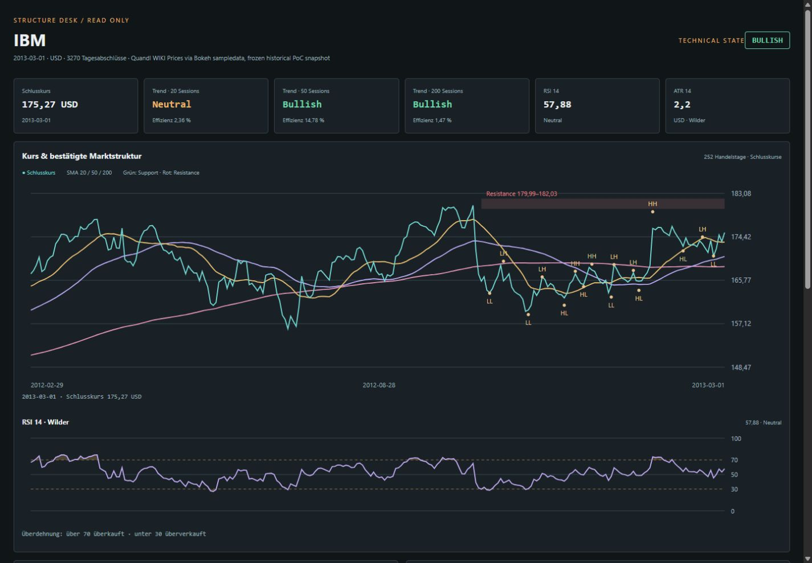
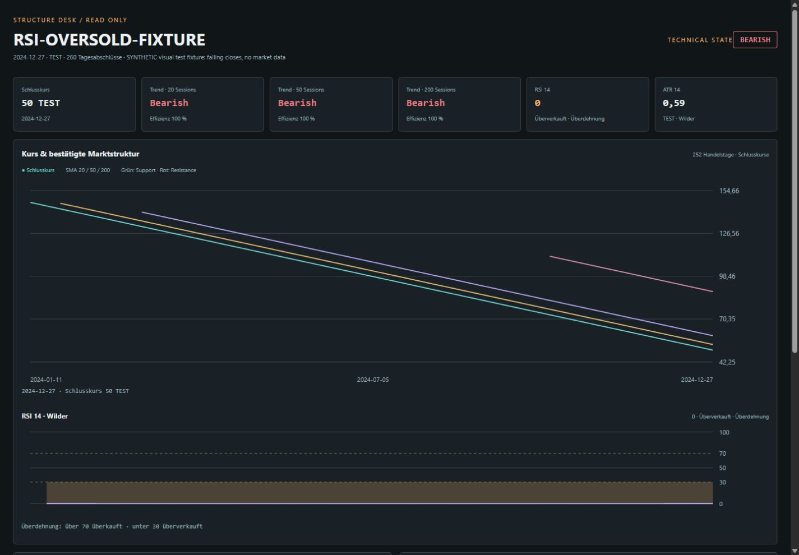
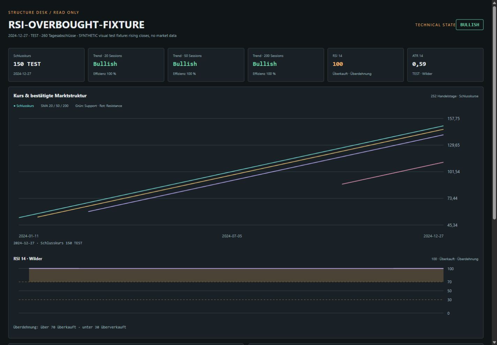

# RSI presentation and joint acceptance of PR #4 / PR #5

Date: 2026-11-08. Review artifacts only; no deployment or merge into `main`.
This directory intentionally includes the generated HTML/JSON and screenshots
requested for visual acceptance. They contain public historical observations or
explicitly labelled synthetic visual fixtures, not private workstation data.

## Open the actual interface

- [IBM standalone index.html](index.html) — download and open locally, no server
  or installation needed. Historical snapshot as of **2013-03-01**, not live data.
- [IBM machine-readable report](report.json).
- [Oversold visual fixture](oversold/index.html): synthetic falling closes, RSI0,
  technical state BEARISH, amber overextension instead of a Bullish RSI class.
- [Overbought visual fixture](overbought/index.html): synthetic rising closes,
  RSI100, technical state BULLISH, amber overextension instead of a Bearish RSI class.

The fixtures are explicitly marked SYNTHETIC, use TEST units, and are only visual
acceptance examples. They are not additional historical research or market data.
The IBM report uses the frozen CSV with SHA-256
`a656c3bcc4ee3254b19cfe44b8613399602815c59beae2eb5d71dcef34752975`,
already documented in `experiments/structure_desk/demo-sources.json`. Its source
is Quandl WIKI Prices via Bokeh sampledata. OHLC use the documented retrospective
adjustment factor; source/revision limitations remain visible in the export.

## Corrected presentation

RSI <30 and >70 share the non-directional `rsi-extension` style, computed color
`rgb(240, 181, 109)`, and an explicit Überdehnung label. This applies to both the
card and the curve's extreme-area shading. RSI30/70 remain inside the ordinary
neutral range. `rsi-neutral` uses the normal text color. Technical direction
classes remain reserved for the separate directional assessment.

The deterministic engine and its votes did not change. Five new full-render
regressions exercise RSI20/30/50/70/80 while preserving the independent BEARISH
assessment. They failed before the presentation correction and pass afterward.
On Windows, the Node output is decoded explicitly as UTF-8.

## Joint integration evidence

Both branches were combined in a **local-only** validation worktree. Neither PR
was merged into `main`, and the validation branch was not published.

| Input | Exact tested revision |
|---|---|
| Common upstream base | `8e9246bdfa87fac2c0ed6f6f488419e699cd043f` |
| PR #4 | `41d2f5a505c2a81b748833a64f99ea829033fa6f` |
| PR #5 code including RSI correction | `2fcb5e077b95b69c04d56da333c1cbcb6c204203` |
| Temporary integration commit | `3c881a031b92fd0e8bfa919b14c553338f37a95a` |

The integration commit has the two PR revisions as its parents. Merge was
conflict-free. Application modules/tests/P0 documentation match PR #4; Structure
Desk source matches PR #5. Later commits on PR #5 add only these generated
acceptance artifacts and documentation; the tested source code is unchanged.

From the combined checkout, using the existing Python environment with the
application and development dependencies:

```text
python -m pytest tests experiments --tb=short
# 117 passed, 1 existing optional TestClient deprecation warning
python -m ruff check stock_trading_agent tests experiments/structure_desk
# All checks passed
node --check experiments/structure_desk/view.js
# exit 0
```

The 117 cases are the46 original tests,37 P0 regression cases and34 Structure
Desk cases. Node was installed: the optional rendering/geometry cases passed,
none were skipped. Standalone PR #5 also passes80 tests (46+34).

Independent read-only review in a separate agent context reran the full117 cases,
Ruff and JavaScript syntax check, and checked both code trees against their
respective merge parents. Verdict PASS, no material findings. This is recorded
local review evidence, **not a formal submitted GitHub review or CI status**.

## Browser acceptance

At1440×1000, actual computed colors/classes and labels were checked for both
extremes and the neutral IBM RSI57.88. Both charts rendered; no browser script
errors observed. At360×800, IBM and the long-title overbought fixture had no
horizontal overflow; IBM SVG had no NaN/Infinity coordinates. Viewport reset
afterward; the owned temporary loopback preview server was stopped.

### IBM: actual historical interface



### Oversold is not a Bullish RSI class



### Overbought is not a Bearish RSI class



No next-stage feature work is included. Production integration and any decision
to merge remain outside this acceptance task; PR #4 and PR #5 stay open.
